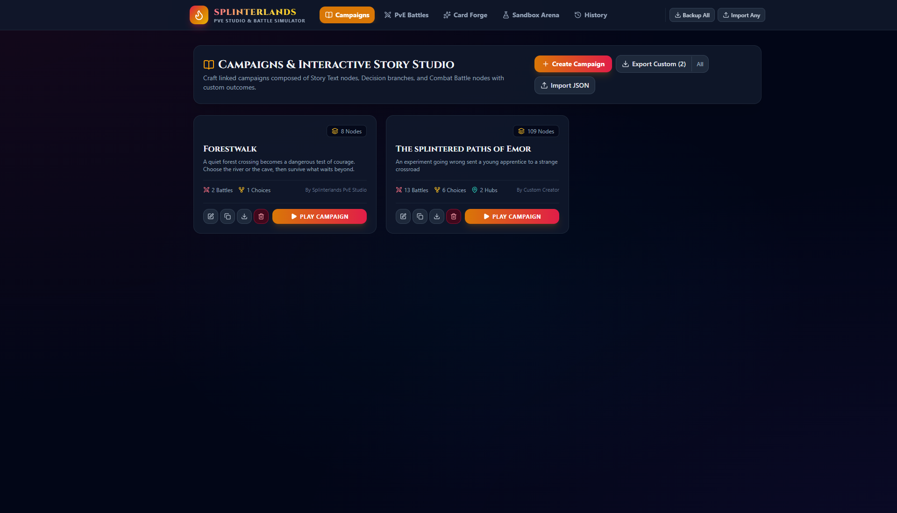
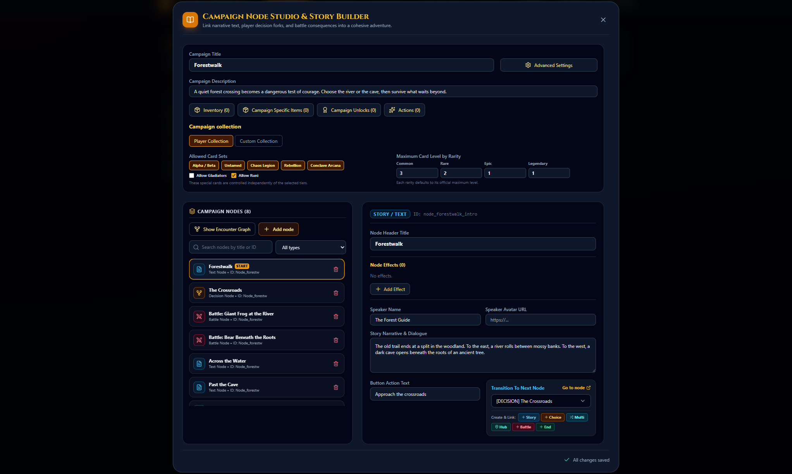

# Splinterlands PvE Studio

## Tagline

Build the battles. Shape the story.

## Short Description

Create custom Splinterlands-style cards, PvE encounters, and branching campaigns in one local-first editor. Test teams in the battle simulator, then turn your ideas into a replayable adventure.

## One-Line Description

A creative studio for custom cards, tactical PvE battles, and story-driven campaigns.

## Longer Description

Splinterlands PvE Studio is a standalone toolkit for designing and playing custom card-battle adventures. Build a campaign from connected story, choice, hub, shop, and battle nodes. Create cards and encounters, shape campaign-specific collections and rewards, and test combat in the sandbox. Campaigns and local creations can be exported as JSON and moved between installations.

## Feature Highlights

- **Campaign builder:** Link narrative scenes, decisions, hubs, shops, battles, and endings in a visual node workflow.
- **Custom cards and collections:** Design cards and define a campaign's starting collection without requiring a synced account.
- **PvE encounter editor:** Create enemy teams, rulesets, and mana limits, then link encounters into campaigns.
- **Campaign progression:** Add inventory, unlocks, reusable actions, card rewards, and optional shared mana.
- **Battle sandbox and history:** Simulate team matchups, inspect battle logs, and replay recorded fights.
- **Local-first workflow:** Save creations beside the app and import or export campaign JSON.

## Screenshots

### Campaign Library

Browse campaigns, compare their branches and battles, then play, edit, duplicate, or export them.

### Campaign Editor

Edit campaign settings and story nodes, inspect the node graph, and connect narrative transitions from one workspace.

